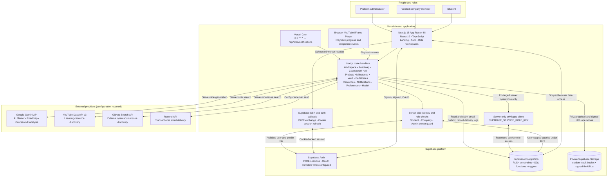

# BuildBridge System Architecture

> **Bridging traditional learning to real-world work.**

This document describes the architecture of the **original BuildBridge application** in the [`BuildBridge`](https://github.com/sukumarisadhukhan/BuildBridge) repository. The separate demo repository should link here rather than publish a second, different architecture diagram.

## Scope and accuracy

The diagram is a code-informed logical view of the current repository: Next.js App Router pages and route handlers, Supabase clients and data services, configured Vercel scheduling, and external provider integrations referenced by the code.

External integrations are conditional. Gemini, YouTube, GitHub and Resend requests require the corresponding server configuration and provider access. Their presence in the architecture does not mean that every provider is enabled or that every end-to-end flow has been validated in Production. The demo deployment is intended to use synthetic data and simulated actions; it does not change the original product architecture shown here.

## Logical architecture

## Runtime components

### 1. Client application and workspaces

The Next.js App Router serves the public landing page, account flows, certificate verification pages and authenticated workspaces. The shared workspace shell selects navigation and capabilities based on the authenticated profile role:

- **Student:** career pathway, coursework mapping, learning resources, AI Mentor, projects, open-source discovery, opportunities, submissions, Learning & Work Vault, achievements and preferences.
- **Company:** company profile and settings, project/opportunity management, applications, assignments, milestone submissions and reviews, and company certificate authorisation.
- **Administrator:** company verification, practice-project moderation, platform certificates, user/access management, disputes, AI management, audit trail, platform health and settings.

The UI uses the Supabase browser client for authentication and scoped database interactions, and calls Next.js route handlers for server-side workflows. Database Row Level Security remains a separate enforcement boundary; UI visibility is not authorisation.

### 2. Authentication and authorisation

- Supabase Auth manages user identities and sessions. The auth form uses Supabase sign-in and OAuth flows; the application callback exchanges the provider code and establishes the application session.
- `@supabase/ssr` is used by server components and middleware to read and refresh cookie-backed sessions.
- Protected workspace routes load the authenticated user and corresponding `profiles` record on the server.
- API requests authenticate the Supabase user from the session or bearer token and perform role checks before sensitive operations.
- Public sign-up creates a student account. Company access is a separate workflow and is not granted merely because a user selects a company representative option.
- Administrator access is not self-selected at sign-up. The platform owner is provisioned separately and checked against `ADMIN_OWNER_EMAIL` and the `platform_admin_owner` record.
- `SUPABASE_SERVICE_ROLE_KEY` is used only by server-side privileged tasks. It must never be exposed through a `NEXT_PUBLIC_` variable or committed to source control.

### 3. Application and API layer

The route handlers group the server-side product workflows:

| Route area | Responsibility |
|---|---|
| `/api/backend` | Authenticated workspace data and role-aware actions. |
| `/api/roadmap` | Career roadmap generation and persistence. |
| `/api/coursework` and `/api/coursework/quiz` | Syllabus/assignment analysis, coursework maps, theory checks, grading and theory certificates. |
| `/api/ai` | Context-aware AI Mentor requests and AI usage event recording. |
| `/api/resources` and `/api/resources/playback` | YouTube recommendations, saved resources, learning activity and playback sessions. |
| `/api/projects` and `/api/projects/[projectId]/*` | Project publishing, assignment and milestone workflows. |
| `/api/external-projects` | External GitHub issue discovery. |
| `/api/vault` | Student evidence aggregation, file upload, signed access URLs and artifact management. |
| `/api/certificates` and `/api/certificates/verify/*` | Credential creation, authorised updates and public verification. |
| `/api/company-domain` | Company registration details, domain TXT verification and administrator decisions. |
| `/api/notifications` and `/api/preferences` | In-app notifications and user notification settings. |
| `/api/health` | Configuration and provider reachability diagnostics. |
| `/api/cron/notifications` | Scheduled deadline reminder and email outbox processing. |

Normal user-scoped queries use the authenticated user's Supabase context and are subject to RLS. Privileged operations use a server-only admin client for tightly scoped tasks such as protected company review, answer-key grading and the email worker.

### 4. Supabase data and storage layer

Supabase provides authentication, PostgreSQL and private file storage. The principal data domains represented in the current SQL and application code are:

| Domain | Representative records |
|---|---|
| Identity and organisation | `profiles`, `companies`, `company_domain_requests`, `company_domains`, `platform_admin_owner` |
| Career, learning and skills | `student_roadmaps`, `coursework_maps`, `coursework_quizzes`, `coursework_quiz_attempts`, `theory_certificates`, `learning_activity`, `learning_bookmarks`, `learning_playback_sessions`, `skill_evidence` |
| Projects and professional work | `projects`, `project_milestones`, `opportunities`, `applications`, `project_assignments`, `project_assignment_milestones`, `project_milestone_progress`, `submissions` |
| Vault and credentials | `student_vault_artifacts`, `certificates`, `theory_certificates`, private objects in the `student-vault` Storage bucket |
| Platform operations | `notifications`, `notification_preferences`, `email_outbox`, `email_delivery_logs`, `deadline_reminder_log`, `ai_usage_events`, `audit_logs` |

The exact migration state of a hosted Supabase project must be checked independently. The SQL files in GitHub are migration source, not evidence that those migrations have already been applied to Production.

### 5. External integrations

| Integration | Used for | Configuration / boundary |
|---|---|---|
| Google Gemini | AI Mentor, career roadmap generation and coursework analysis. | Server-side `GEMINI_API_KEY`; model selection may use `GEMINI_MODEL` and `GEMINI_FALLBACK_MODELS`. |
| YouTube Data API v3 | Search and retrieve embeddable learning videos and metadata. | Server-side `YOUTUBE_API_KEY`; quota and provider errors are surfaced by the API. |
| YouTube IFrame Player | In-browser video playback and genuine playback-progress events. | Embedded player; completion is recorded after continuous playback reaches 100%. |
| GitHub Search API | Discover open, non-pull-request issues labelled `good first issue` or `help wanted`, excluding archived repositories when identifiable. | Public API; optional server-side `GITHUB_TOKEN` improves rate limits. Results remain external listings. |
| Resend | Transactional email delivery from the notification outbox. | Requires server-side `RESEND_API_KEY`, `EMAIL_FROM`, `APP_BASE_URL` and the scheduled worker's `CRON_SECRET`. A configured key alone is not proof of delivery. |

OAuth providers such as Google, GitHub, LinkedIn OIDC and Microsoft/Azure are configured in Supabase Auth. Provider credentials and redirect allowlists live in Supabase and the identity provider consoles, not in this repository.

### 6. Notification and email processing

The notification workflow separates in-app notifications from outbound email:

1. Product workflows create in-app notification records and, where configured, queue email work in `email_outbox`.
2. Vercel Cron invokes `/api/cron/notifications` on the schedule in `vercel.json` (`0 8 * * *`).
3. The worker uses the server-only Supabase admin client to process due reminders and claim pending outbox items.
4. User preferences are checked before delivery. The worker sends eligible messages through Resend with an idempotency key.
5. Delivery outcomes are written to the outbox and `email_delivery_logs` as sent, suppressed or failed.

Email delivery remains dependent on valid provider credentials, a verified sender identity and the deployed cron configuration. Authentication emails sent by Supabase are separate from BuildBridge application-triggered transactional emails.

## Important workflow boundaries

### Company verification

A company representative submits organisation details and verifies control of the declared domain using a DNS TXT record. The request then enters a separate administrator review. Company publishing and approval actions require the correct verified company context. DNS proof by itself does not grant verified-company access.

### Project evidence and approvals

Practice projects, verified-company assignments and external GitHub issues are distinct work types. Students submit evidence against project or milestone requirements. For company work, the assigning verified company performs the review and approval. Administrators do not approve company work on the company's behalf.

### Credentials

BuildBridge separates:

- platform-issued learning or skill credentials;
- theory-learning certificates issued after a knowledge check meeting the score threshold;
- company project-completion certificates issued only after the assigning company's required milestone approvals and authorised signatory process.

A course certificate, practice project or AI response is not automatically professional experience.

## Deployment and environment boundaries

The original application is hosted on Vercel and uses a separately managed Supabase project. Keep the following operations separate:

- Deploying Next.js code to Vercel.
- Configuring Production and Preview environment variables.
- Applying the correct Supabase initial schema or additive migrations.
- Configuring Supabase Auth providers and redirect URLs.
- Configuring external AI, YouTube, GitHub and email providers.

A successful Vercel build does not apply SQL migrations. A successful `/api/health` response does not certify all database tables, RLS policies, Storage operations, AI generation or email delivery. Run the preflight and postflight scripts and follow [`DATABASE-MIGRATIONS.md`](DATABASE-MIGRATIONS.md) and [`DEPLOYMENT.md`](DEPLOYMENT.md).

## Related repositories

- **Original application:** https://github.com/sukumarisadhukhan/BuildBridge
- **Interactive synthetic-data demo:** https://github.com/sukumarisadhukhan/BuildBridge-Demo

The demo README should link to this architecture document. It should not define a separate backend architecture or imply that its synthetic data is production data.
